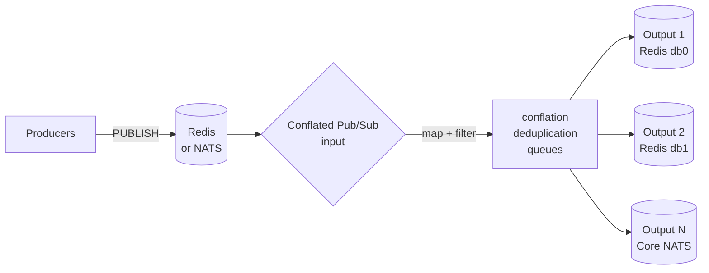

# Conflated Pub/Sub

**Conflated Pub/Sub** is a Rust relay that forwards Pub/Sub messages between
**Redis** and **Core NATS**. The input selects one backend and every output
independently selects Redis or Core NATS; channel mapping, filters, conflation and
deduplication behave the same way for every combination.

[Download a binary](https://github.com/rspadim/redis-conflated-pubsub/releases){ .md-button .md-button--primary }
[View the source](https://github.com/rspadim/redis-conflated-pubsub){ .md-button }

## What it solves

You have an event feed (quotes, telemetry, signals) publishing far more messages
than consumers can — or need to — process. The relay sits in the middle and
delivers only what matters:

- **Conflation**: keeps only the latest value per channel inside a window
  (`interval_ms`) and publishes in `MULTI`/`EXEC` transactions.
- **Deduplication**: suppresses consecutive identical payloads for a TTL, per
  channel or per group that shares a deadline.
- **Channel filters**: ordered rules with `glob`, `regex` or literal equality, on
  the input and on each output.
- **Independent backends**: Redis `SUBSCRIBE`/`PSUBSCRIBE` or Core NATS
  (`nats_subject`), in any input/output combination.
- **Operations**: configuration reload on `SIGHUP`, JSON status snapshot,
  per-output HTTP metrics and a Zabbix template.

## Observed reduction

An anonymized v0.1.2 snapshot after about 16 seconds: **28,482 input / 9,320 output
messages (67.28% fewer)** and **581,458 / 450,218 payload bytes (22.57% fewer)**.
The numbers are workload-specific. Details and caveats in
[Architecture](design.md).

## Next steps

- :material-rocket-launch:{ .lg .middle } **[Quick start](inicio-rapido.md)**

    Download the binary, validate a configuration and run it against a local Redis.

- :material-tuning:{ .lg .middle } **[Configuration](configuracao.md)**

    Full field reference, profiles, channel policies, filters and queues.

- :material-transit-connection-variant:{ .lg .middle } **[NATS backend](nats.md)**

    Authentication, TLS/mTLS, subject wildcards and the loop guard.

- :material-docker:{ .lg .middle } **[Docker and tests](docker.md)**

    Single-container image with Redis/Valkey, integration tests and benchmarks.

- :material-chart-line:{ .lg .middle } **[Operations](operacao.md)**

    systemd, `SIGHUP`, the status endpoint and Zabbix monitoring.

- :material-file-tree:{ .lg .middle } **[Architecture](design.md)**

    How the runtime is organized and which mechanisms are behind it.

!!! note "Scope"
    **Ephemeral Pub/Sub only.** JetStream (persistence, acknowledgement, durable
    replay) and Redis Streams are **permanently out of scope**: the relay's
    contract is Pub/Sub without replay.

!!! tip "Translations are welcome"
    This site ships in Portuguese, English and Spanish. If you are a native
    speaker of another language — or found a mistake in one of these — open a
    [translation issue](https://github.com/rspadim/redis-conflated-pubsub/issues/new?template=translation.yml)
    and send the pages as a pull request. The conventions are in
    [Development](desenvolvimento.md#help-translate).
