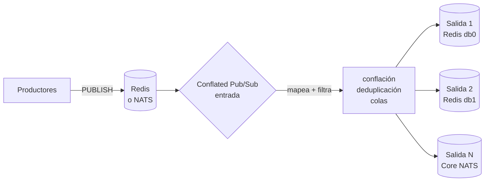

# Conflated Pub/Sub

**Conflated Pub/Sub** es un relay escrito en Rust que reenvía mensajes Pub/Sub
entre **Redis** y **Core NATS**. La entrada selecciona un backend y cada salida
elige Redis o Core NATS **de forma independiente**; el mapeo de canales,
los filtros, la conflación y la deduplicación funcionan del mismo modo para
cualquier combinación.

[Descargar binario](https://github.com/rspadim/redis-conflated-pubsub/releases){ .md-button .md-button--primary }
[Ver el código en GitHub](https://github.com/rspadim/redis-conflated-pubsub){ .md-button }

## Qué resuelve

Tienes un feed de eventos (cotizaciones, telemetría, señales) que publica muchas
más mensajes de los que los consumidores pueden — o necesitan — procesar. El
relay queda en medio del camino y entrega solo lo que importa:

- **Conflación**: conserva solo el valor más reciente por canal dentro de una
  ventana (`interval_ms`) y publica en transacciones `MULTI`/`EXEC`.
- **Deduplicación**: suprime payloads idénticos consecutivos durante un TTL, por
  canal o por grupos que comparten plazo.
- **Filtros por canal**: reglas ordenadas con `glob`, `regex` o igualdad
  literal, en la entrada y en cada salida.
- **Backends independientes**: Redis `SUBSCRIBE`/`PSUBSCRIBE` o Core NATS
  (`nats_subject`), en cualquier combinación entrada/salida.
- **Operación**: recarga de configuración por `SIGHUP`, snapshot de estado en
  JSON, métricas por HTTP y plantilla de Zabbix.

## Reducción observada

Un snapshot anonimizado de la v0.1.2 tras unos 16 segundos: **28.482 mensajes de
entrada / 9.320 de salida (67,28% menos)** y **581.458 / 450.218 bytes de
payload (22,57% menos)**. Los números dependen de la carga. Detalles y salvedades
en [Arquitectura](design.md).

## Próximos pasos

- :material-rocket-launch:{ .lg .middle } **[Inicio rápido](inicio-rapido.md)**

    Descarga el binario, valida una configuración y ejecútalo contra un Redis local.

- :material-tune:{ .lg .middle } **[Configuración](configuracao.md)**

    Referencia completa de campos, perfiles, políticas de canal, filtros y colas.

- :material-transit-connection-variant:{ .lg .middle } **[Backend NATS](nats.md)**

    Autenticación, TLS/mTLS, wildcards de subject y la guarda de bucle.

- :material-docker:{ .lg .middle } **[Docker y pruebas](docker.md)**

    Imagen única con Redis/Valkey, pruebas de integración y benchmarks.

- :material-chart-line:{ .lg .middle } **[Operación](operacao.md)**

    systemd, `SIGHUP`, endpoint de estado y monitoreo Zabbix.

- :material-file-tree:{ .lg .middle } **[Arquitectura](design.md)**

    Cómo se organiza el runtime y cuáles son los mecanismos internos.

!!! note "Alcance"
    Solo **Pub/Sub efímero**. JetStream (persistencia, ack, replay duradero) y
    Redis Streams están **permanentemente fuera de alcance**: el contrato del
    relay es de Pub/Sub sin replay.

!!! tip "Las traducciones son bienvenidas"
    Este sitio se publica en portugués, inglés y español. Si eres nativo de otro
    idioma — o encontraste un error en alguno de estos — abre un
    [issue de traducción](https://github.com/rspadim/redis-conflated-pubsub/issues/new?template=translation.yml)
    y envía las páginas como pull request. Las convenciones están en
    [Desarrollo](desenvolvimento.md#ayuda-a-traducir).
