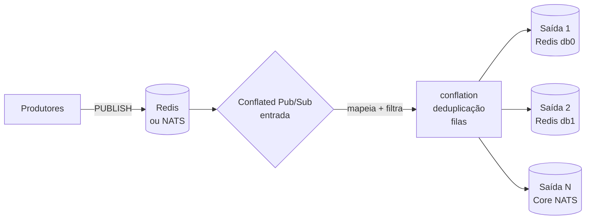

# Conflated Pub/Sub

**Conflated Pub/Sub** é um relay escrito em Rust que encaminha mensagens Pub/Sub
entre **Redis** e **Core NATS**. A entrada seleciona um backend e cada saída
escolhe Redis ou Core NATS **de forma independente**; mapeamento de canais,
filtros, conflation e deduplicação funcionam do mesmo jeito para qualquer
combinação.

[Baixar binário](https://github.com/rspadim/redis-conflated-pubsub/releases){ .md-button .md-button--primary }
[Ver código no GitHub](https://github.com/rspadim/redis-conflated-pubsub){ .md-button }

## O que ele resolve

Você tem um feed de eventos (cotações, telemetria, sinais) publicando muito mais
mensagens do que os consumidores conseguem — ou precisam — processar. O relay
fica no meio do caminho e entrega apenas o que importa:

- **Conflation**: mantém só o valor mais recente por canal dentro de uma janela
  (`interval_ms`) e publica em transações `MULTI`/`EXEC`.
- **Deduplicação**: suprime payloads idênticos consecutivos por um TTL, por canal
  ou por grupos que compartilham prazo.
- **Filtros por canal**: regras ordenadas com `glob`, `regex` ou igualdade
  literal, na entrada e em cada saída.
- **Backends independentes**: Redis `SUBSCRIBE`/`PSUBSCRIBE` ou Core NATS
  (`nats_subject`), em qualquer combinação entrada/saída.
- **Operação**: recarga de configuração por `SIGHUP`, snapshot de status em JSON,
  métricas por HTTP e template de Zabbix.

## Resultado observado

Um snapshot anonimizado da v0.1.2 após cerca de 16 segundos: **28.482 mensagens
de entrada / 9.320 de saída (67,28% menos)** e **581.458 / 450.218 bytes de
payload (22,57% menos)**. Os números dependem da carga. Detalhes e ressalvas em
[Arquitetura](design.md).

## Próximos passos

- :material-rocket-launch:{ .lg .middle } **[Início rápido](inicio-rapido.md)**

    Baixe o binário, valide uma configuração e rode contra um Redis local.

- :material-tuning:{ .lg .middle } **[Configuração](configuracao.md)**

    Referência completa de campos, perfis, políticas de canal, filtros e filas.

- :material-transit-connection-variant:{ .lg .middle } **[Backend NATS](nats.md)**

    Autenticação, TLS/mTLS, wildcards de subject e o loop guard.

- :material-docker:{ .lg .middle } **[Docker e testes](docker.md)**

    Imagem única com Redis/Valkey, testes de integração e benchmarks.

- :material-chart-line:{ .lg .middle } **[Operação](operacao.md)**

    systemd, `SIGHUP`, endpoint de status e monitoramento Zabbix.

- :material-file-tree:{ .lg .middle } **[Arquitetura](design.md)**

    Como o runtime é organizado e quais são os mecanismos internos.

!!! note "Escopo"
    Apenas **Pub/Sub efêmero**. JetStream (persistência, ack, replay durável) e
    Redis Streams estão **permanentemente fora de escopo**: o contrato do relay é
    de Pub/Sub sem replay.

!!! tip "Traduções são bem-vindas"
    Este site é publicado em português, inglês e espanhol. Se você é nativo de
    outro idioma — ou achou um erro em um destes — abra uma
    [issue de tradução](https://github.com/rspadim/redis-conflated-pubsub/issues/new?template=translation.yml)
    e mande as páginas como pull request. As convenções estão em
    [Desenvolvimento](desenvolvimento.md#ajude-a-traduzir).
